# QEMU Hardware Device Emulation Tutorial

A practical guide to modeling hardware in QEMU: how QEMU is structured, how a device is declared, mapped, wired to a board, driven by timers, debugged, and tested.

Code samples use a made-up device called `mydev` and follow recent QEMU conventions. Header names and helper signatures change between releases, so check them against your QEMU tree.

## Contents

1. [What QEMU does](#1-what-qemu-does)
2. [The machine tree](#2-the-machine-tree)
3. [Source tree and building](#3-source-tree-and-building)
4. [QOM: the QEMU object model](#4-qom-the-qemu-object-model)
5. [qdev: the device layer](#5-qdev-the-device-layer)
6. [Modeling a device: datasheet to QEMU](#6-modeling-a-device-datasheet-to-qemu)
7. [Register decode: read and write](#7-register-decode-read-and-write)
8. [MMIO in depth](#8-mmio-in-depth)
9. [Bus devices: I2C](#9-bus-devices-i2c)
10. [GPIO lines and IRQs](#10-gpio-lines-and-irqs)
11. [Timers](#11-timers)
12. [VMState: describing device state](#12-vmstate-describing-device-state)
13. [Build integration](#13-build-integration)
14. [Using and debugging your device](#14-using-and-debugging-your-device)
15. [Testing with qtest](#15-testing-with-qtest)
16. [Common pitfalls](#16-common-pitfalls)
17. [Checklist](#17-checklist)
18. [Glossary](#18-glossary)

---

## 1. What QEMU Does

QEMU runs a **guest program** on **emulated hardware**. It simulates every CPU, register, and peripheral. Each of these is a **C object inside a QEMU process**.

- **System mode** (`qemu-system-<arch>`) emulates a whole board, not just a CPU.
- The CPU is emulated with **TCG (Tiny Code Generator)**, a just-in-time compiler that translates guest machine code into native code the host CPU can run.
- When guest code touches a peripheral address, QEMU calls that peripheral's C **read or write function**. This is **MMIO** (memory-mapped I/O).

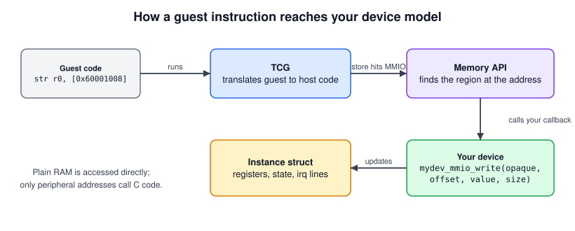

Your job as a device author: **turn a datasheet into a small C state machine** that reacts to bus events and pin changes. A device model is a C object that behaves like the chip *and its boundaries*, at the **transaction level**: you handle "a byte was written" or "a pin went high", not clock edges or voltages.

---

## 2. The Machine Tree

QEMU hardware is modeled as a tree:

| Level | Role |
|---|---|
| **Machine** (`-M <name>`) | The board. Its init function creates the SoC and wires everything together. |
| **SoC** | Owns the CPU, memory map, and on-chip peripherals (I2C controllers, GPIO controllers, ...). |
| **Bus** (I2C, SPI, ...) | Connects a controller to the devices on it. |
| **Device** | Anything that is attached. |

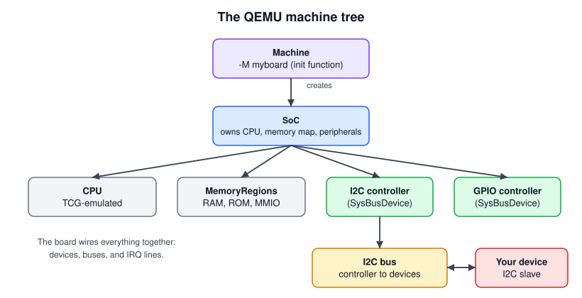

---

## 3. Source Tree and Building

| Path | Contents |
|---|---|
| `hw/` | Device models |
| `include/hw/` | Device model headers |
| `hw/<arch>/` | Machine / board code |
| `tests/qtest/` | Device tests |

QEMU builds with **configure + Meson + Ninja** and is normally built **out of tree**. You can build only the targets you need:

```sh
mkdir build && cd build
../configure --target-list=<arch>-softmmu
ninja
```

---

## 4. QOM: The QEMU Object Model

QOM is how C gets **classes, inheritance, and runtime type checks**. Every device is a QOM object.

You **declare a type once**, **register it at startup**, and QEMU can then create instances of it.

### 4.1 Two structs per type

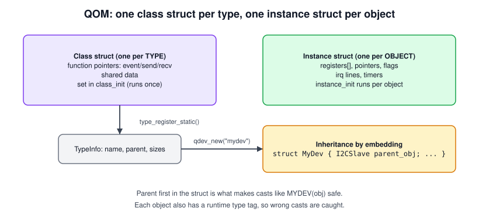

| Struct | Count | Holds |
|---|---|---|
| **Class struct** | one per *type* | Function pointers and shared data |
| **Instance struct** | one per *object* | Per-device state (registers, pointers) |

Example: an I2C slave's class struct carries the `send`, `recv`, and `event` callbacks; your instance struct carries your registers.

### 4.2 Init hooks

- `class_init` runs **once per type**. Fill in callbacks here.
- `instance_init` runs **once per object**, right after allocation and **before properties are set**.

### 4.3 Declaring a type

```c
#define TYPE_MYDEV "mydev"
OBJECT_DECLARE_SIMPLE_TYPE(MyDevState, MYDEV)

struct MyDevState {
    I2CSlave parent_obj;      /* parent first: this is how inheritance works */

    /* registers */
    uint8_t regs[MYDEV_NUM_REGS];
    uint8_t ptr;              /* current register pointer */
    bool    got_ptr;

    /* wiring */
    qemu_irq irq_out;
    uint8_t  pin_in_level;
    QEMUTimer *timer;
};

static const TypeInfo mydev_info = {
    .name          = TYPE_MYDEV,
    .parent        = TYPE_I2C_SLAVE,
    .instance_size = sizeof(MyDevState),
    .class_init    = mydev_class_init,
};

static void mydev_register_types(void)
{
    type_register_static(&mydev_info);
}
type_init(mydev_register_types)
```

---

## 5. qdev: The Device Layer

**qdev sits on top of QOM** and adds what makes it "real hardware": a **lifecycle**, **reset**, **configurable properties**, **buses**, and **GPIO lines**. Every device you write is a `DeviceState`.

### 5.1 Lifecycle

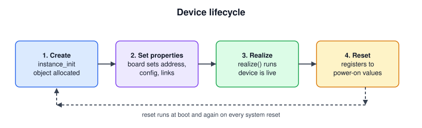

1. **Create**: the object is allocated and `instance_init` runs.
2. **Set properties**: the board sets values (for example, the I2C address).
3. **Realize**: `realize` runs and the device becomes live.
4. **Reset**: registers go to their power-on values. Reset runs at boot and on every system reset.

### 5.2 Properties

A property is a **typed, named field that board code can set before realize**, such as an I2C address or a clock frequency.

```c
static Property mydev_properties[] = {
    DEFINE_PROP_UINT8("config", MyDevState, cfg, 0),
    DEFINE_PROP_END_OF_LIST(),
};
```

Validate properties in `realize` and report problems through `errp`, so a bad board configuration fails loudly instead of misbehaving at runtime.

### 5.3 class_init: tying it together

```c
static void mydev_class_init(ObjectClass *klass, void *data)
{
    DeviceClass   *dc = DEVICE_CLASS(klass);
    I2CSlaveClass *sc = I2C_SLAVE_CLASS(klass);

    dc->realize  = mydev_realize;
    dc->vmsd     = &vmstate_mydev;
    device_class_set_props(dc, mydev_properties);
    device_class_set_legacy_reset(dc, mydev_reset);

    sc->event = mydev_event;
    sc->send  = mydev_send;
    sc->recv  = mydev_recv;
}
```

### 5.4 Reset

Reset puts the device **back into its power-on state**. Put all power-on values in the reset handler (not only in `realize`) so a guest-triggered reset behaves like real hardware. Reset must also **re-drive outputs** and **cancel pending timers**.

```c
static void mydev_reset(DeviceState *dev)
{
    MyDevState *s = MYDEV(dev);

    timer_del(s->timer);
    memset(s->regs, 0, sizeof(s->regs));
    s->regs[REG_DIRECTION] = 0xFF;   /* whatever the datasheet says */
    s->got_ptr = false;
    mydev_update_outputs(s);         /* make pins reflect reset state */
}
```

---

## 6. Modeling a Device: Datasheet to QEMU

### 6.1 Map the spec to QEMU mechanisms

For **each line of your datasheet**, decide which QEMU mechanism carries it:

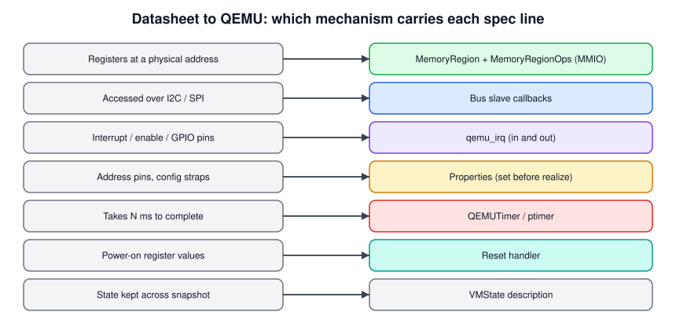

### 6.2 Building blocks

- **QOM types**: class struct and instance struct.
- **qdev** (`DeviceState`): layer on top of QOM.
- **Buses and bus slaves**: connect a controller to devices (I2C slave, SSI peripheral).
- **`MemoryRegion` / `MemoryRegionOps`**: how a peripheral's registers appear at a physical address (MMIO; used for read and write callbacks).
- **`SysBusDevice`**: the device type for things that interact directly with the system address space.
- **`qemu_irq`**: a one-bit signal a device drives and another receives.
- **Properties**: typed settings the board sets before the device goes live.
- **Timers** (`QEMUTimer`, `ptimer`): anything that takes time. QEMU does not sleep; it uses callbacks.
- **VMState**: the device's mutable state, for snapshots and migration.
- **Reset**: the hook that puts the device back into its power-on state.

> A **callback** is a C function whose pointer you hand to QEMU, so QEMU can "call back" when a specific event happens.

### 6.3 Header and state struct

Put the **type name, register offsets, and state struct in a public header** (`include/hw/...`) so the board and the model agree on them.

```c
/* include/hw/misc/mydev.h */
#define TYPE_MYDEV "mydev"

enum {
    REG_DIRECTION  = 0x00,
    REG_POLARITY   = 0x01,
    REG_DATA       = 0x02,
    REG_LATCH      = 0x03,
    REG_STATUS     = 0x04,
    MYDEV_NUM_REGS = 0x08,
};
```

### 6.4 Recommended file layout

```
include/hw/misc/mydev.h     type name, register offsets, state struct
hw/misc/mydev.c             model
hw/misc/trace-events        trace points (optional but highly recommended)
hw/misc/Kconfig             CONFIG_MYDEV
hw/misc/meson.build         build rule
tests/qtest/mydev-test.c    qtest
```

---

## 7. Register Decode: Read and Write

The register layer has **three jobs**:

1. Turn a **guest address/offset into a register**.
2. Apply **side effects** (reading a register clears a flag, writing starts a transfer, ...).
3. Apply **write rules** (read-only bits, write-1-to-clear, reserved bits).

Keep this layer **free of bus specifics**. The same functions can then be reused behind MMIO, I2C, or SPI.

```c
static uint8_t mydev_reg_read(MyDevState *s, uint8_t reg)
{
    switch (reg) {
    case REG_DATA:
        return s->pin_in_level ^ s->regs[REG_POLARITY];
    case REG_STATUS: {
        uint8_t v = s->regs[REG_STATUS];
        s->regs[REG_STATUS] &= ~STATUS_DONE;      /* read-to-clear side effect */
        mydev_update_outputs(s);
        return v;
    }
    default:
        return s->regs[reg];
    }
}

static void mydev_reg_write(MyDevState *s, uint8_t reg, uint8_t val)
{
    switch (reg) {
    case REG_STATUS:
        s->regs[REG_STATUS] &= ~val;              /* write-1-to-clear */
        break;
    case REG_DATA:                                /* writing data writes the latch */
        s->regs[REG_LATCH] = val;
        break;
    default:
        if (reg >= MYDEV_NUM_REGS) {
            qemu_log_mask(LOG_GUEST_ERROR,
                          "mydev: write to bad register 0x%x\n", reg);
            return;
        }
        s->regs[reg] = val;
        break;
    }
    mydev_update_outputs(s);
}
```

Common register behaviors to model, straight from the datasheet:

| Behavior | How |
|---|---|
| Read-only | ignore writes (optionally log with `LOG_GUEST_ERROR`) |
| Write-1-to-clear | `reg &= ~val` |
| Read-to-clear | clear inside the read handler |
| Reserved bits | mask on write; return 0 on read |
| Write-only trigger | action in write handler, nothing stored |
| Auto-increment pointer | bump the pointer after each access |

Use `qemu_log_mask(LOG_GUEST_ERROR, ...)` when the **guest** does something illegal, and `LOG_UNIMP` for hardware features you have not implemented. Both are enabled with `-d guest_errors,unimp`.

---

## 8. MMIO in Depth

For a device that lives **directly in the system address space**, derive from `SysBusDevice`, create a `MemoryRegion`, and provide read/write callbacks.

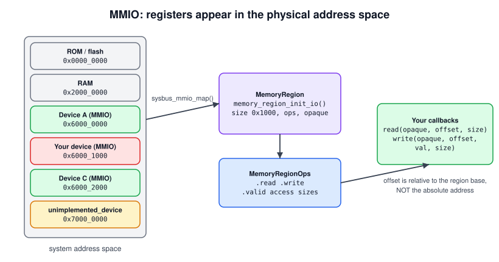

### 8.1 The pieces

| Piece | Purpose |
|---|---|
| `MemoryRegion` | A window of address space that belongs to your device |
| `MemoryRegionOps` | The `read`/`write` callbacks plus access rules |
| `memory_region_init_io()` | Creates the region and binds the ops and your state (`opaque`) |
| `sysbus_init_mmio()` | Exposes the region from the device so the board can map it |
| `sysbus_mmio_map()` | Board code places the region at a physical address |

### 8.2 Implementation

```c
static uint64_t mydev_mmio_read(void *opaque, hwaddr offset, unsigned size)
{
    MyDevState *s = opaque;                 /* the state you passed to init_io */

    switch (offset) {
    case 0x00 ... 0x1c:
        return mydev_reg_read(s, offset >> 2);
    default:
        qemu_log_mask(LOG_GUEST_ERROR,
                      "mydev: bad read offset 0x%" HWADDR_PRIx "\n", offset);
        return 0;
    }
}

static void mydev_mmio_write(void *opaque, hwaddr offset,
                             uint64_t value, unsigned size)
{
    MyDevState *s = opaque;

    if (offset > 0x1c) {
        qemu_log_mask(LOG_GUEST_ERROR,
                      "mydev: bad write offset 0x%" HWADDR_PRIx "\n", offset);
        return;
    }
    mydev_reg_write(s, offset >> 2, value);
}

static const MemoryRegionOps mydev_mmio_ops = {
    .read  = mydev_mmio_read,
    .write = mydev_mmio_write,
    .endianness = DEVICE_LITTLE_ENDIAN,
    .valid.min_access_size = 4,             /* what the guest may issue   */
    .valid.max_access_size = 4,
    .impl.min_access_size  = 4,             /* what your callbacks accept */
    .impl.max_access_size  = 4,
};

static void mydev_mmio_realize(DeviceState *dev, Error **errp)
{
    MyDevState *s = MYDEV(dev);

    memory_region_init_io(&s->iomem, OBJECT(s), &mydev_mmio_ops, s,
                          "mydev", 0x1000);
    sysbus_init_mmio(SYS_BUS_DEVICE(dev), &s->iomem);   /* mmio index 0 */
    sysbus_init_irq(SYS_BUS_DEVICE(dev), &s->irq_out);  /* irq index 0  */
}
```

The **board** then maps it and connects its interrupt:

```c
DeviceState *dev = qdev_new(TYPE_MYDEV);
sysbus_realize_and_unref(SYS_BUS_DEVICE(dev), &error_fatal);
sysbus_mmio_map(SYS_BUS_DEVICE(dev), 0, 0x60001000);
sysbus_connect_irq(SYS_BUS_DEVICE(dev), 0, qdev_get_gpio_in(intc, 12));
```

### 8.3 Details that bite

- **`offset` is relative to the start of your region**, not the absolute physical address.
- **Access size**: `valid` says which sizes the *guest* may use (others fault or are rejected); `impl` says which sizes *your callbacks* handle. If `impl` is narrower than `valid`, QEMU splits wider accesses into several calls for you.
- **Endianness**: set `.endianness` to match the hardware, not the host.
- **Reads can have side effects**: QEMU may call `read` for debugger or monitor accesses too. Mark side-effect reads appropriately or avoid them where hardware permits.
- **Return value of `read`** is a `uint64_t`; return only the bits for the requested `size`.
- **Callbacks must be fast and non-blocking**: they run in the CPU emulation path.

### 8.4 Stubbing out hardware you have not modeled

Guest firmware often probes peripherals you have no model for. Rather than crash on unmapped accesses, map an **unimplemented-device** placeholder:

```c
create_unimplemented_device("mydev-unimp", 0x70000000, 0x1000);
```

Reads return 0, writes are ignored, and with `-d unimp` each access is logged, which tells you exactly what firmware needs next.

### 8.5 Inspecting the memory map

At the QEMU monitor (`-monitor stdio`):

```
(qemu) info mtree
```

shows every region and its address range. Check your device appears where you expect.

---

## 9. Bus Devices: I2C

QEMU models I2C **at the transaction level**. Your device gets a **start** event, **one callback per byte**, then a **stop** event. Every callback runs **synchronously and must return immediately**: no sleeping, no waiting.

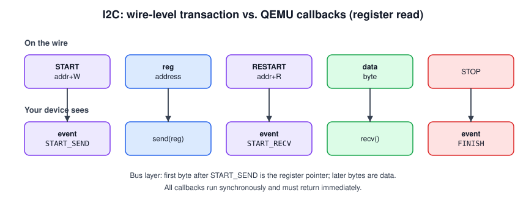

### 9.1 The three callbacks

```c
int     event(I2CSlave *s, enum i2c_event event);
int     send(I2CSlave *s, uint8_t data);      /* controller writes a byte to you */
uint8_t recv(I2CSlave *s);                    /* controller reads a byte from you */
```

| Event | Meaning |
|---|---|
| `I2C_START_SEND` | Start of a write transaction |
| `I2C_START_RECV` | Start of a read transaction |
| `I2C_FINISH` | Stop |
| `I2C_NACK` | Controller NACKed |

### 9.2 Mapping wire-level I2C to callbacks

A typical **register read**: *write the register address, repeated start, read data*.

```
wire:   START addr+W | reg | RESTART addr+R | data | STOP
QEMU:   START_SEND   | send(reg) | START_RECV | recv() | FINISH
```

A typical **register write**: `START addr+W | reg | data | STOP` becomes `START_SEND`, `send(reg)`, `send(data)`, `FINISH`.

### 9.3 Implementation

> The bus layer only tells you "**this byte is a register address**" vs. "**this byte is data**". All register meaning lives in the register layer (section 7).

```c
static int mydev_event(I2CSlave *i2c, enum i2c_event event)
{
    MyDevState *s = MYDEV(i2c);

    switch (event) {
    case I2C_START_SEND:
        s->got_ptr = false;          /* next byte is a register address */
        break;
    case I2C_START_RECV:
    case I2C_FINISH:
    case I2C_NACK:
        break;
    }
    return 0;
}

static int mydev_send(I2CSlave *i2c, uint8_t data)
{
    MyDevState *s = MYDEV(i2c);

    if (!s->got_ptr) {
        s->ptr = data;               /* first byte: register pointer */
        s->got_ptr = true;
    } else {
        mydev_reg_write(s, s->ptr, data);
        s->ptr++;                    /* auto-increment, if the datasheet says so */
    }
    return 0;                        /* 0 = ACK */
}

static uint8_t mydev_recv(I2CSlave *i2c)
{
    MyDevState *s = MYDEV(i2c);
    uint8_t v = mydev_reg_read(s, s->ptr);
    s->ptr++;
    return v;
}
```

### 9.4 Creating and attaching the device (board code)

Board code **creates the I2C device, sets its address, and realizes it**. The shortcut does all three. You need a **pointer to the controller's I2C bus**.

```c
I2CBus *bus = ...;   /* from the SoC's I2C controller */
i2c_slave_create_simple(bus, TYPE_MYDEV, 0x20);
```

The long form shows the lifecycle explicitly:

```c
DeviceState *dev = qdev_new(TYPE_MYDEV);              /* 1. create         */
qdev_prop_set_uint8(dev, "address", 0x20);            /* 2. set properties */
qdev_realize_and_unref(dev, BUS(bus), &error_fatal);  /* 3. realize        */
```

Other buses (SPI/SSI, etc.) follow the same pattern: a controller exposes a bus, your device is a slave type of that bus, and the bus's class struct defines the callbacks.

---

## 10. GPIO Lines and IRQs

In QEMU a **pin**, an **interrupt line**, and a **reset line** are all the **same thing**: a `qemu_irq`. It is a **one-bit signal** that one device drives and another receives, and it **carries a level, not an edge**.

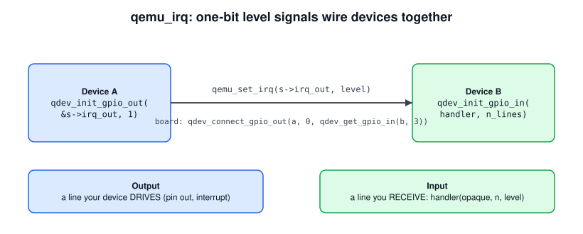

| Direction | Meaning | Created with |
|---|---|---|
| **Output** | A line your device drives | `qdev_init_gpio_out` |
| **Input** | A line your device receives | `qdev_init_gpio_in` |

### 10.1 Inputs: the handler

The **handler is where an external pin change enters your model**.

```c
static void mydev_pin_in(void *opaque, int n, int level)
{
    MyDevState *s = opaque;

    if (level) {
        s->pin_in_level |=  (1u << n);
    } else {
        s->pin_in_level &= ~(1u << n);
    }
    mydev_update_outputs(s);       /* may raise an interrupt */
}

/* in realize or instance_init */
qdev_init_gpio_in(DEVICE(s), mydev_pin_in, 8);   /* 8 input pins */
```

### 10.2 Outputs: driving a line

```c
qdev_init_gpio_out(DEVICE(s), &s->irq_out, 1);   /* in realize/instance_init */

static void mydev_update_outputs(MyDevState *s)
{
    bool active = s->regs[REG_STATUS] & s->regs[REG_ENABLE];
    qemu_set_irq(s->irq_out, active);            /* drive the line */
}
```

An output that is **not connected is safe**: `qemu_set_irq` on an unconnected line is a no-op.

### 10.3 Wiring in board code

```c
qdev_connect_gpio_out(dev_a, 0, qdev_get_gpio_in(dev_b, 3));
```

This connects output 0 of `dev_a` to input 3 of `dev_b`. For named lines, use `qdev_init_gpio_out_named` / `qdev_connect_gpio_out_named` with the same pattern.

### 10.4 Recommended pattern: one `update_outputs`

Keep one function that **recomputes every output from the current state**, and call it from everywhere state can change.

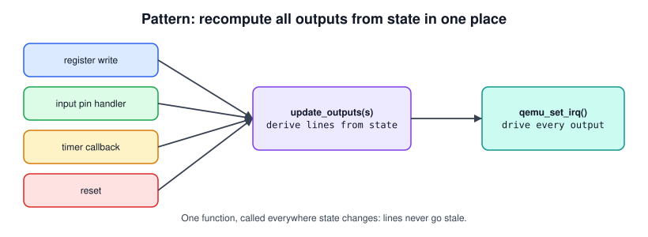

Because `qemu_irq` carries a **level**, an interrupt line stays asserted until the guest clears the cause. Model that: the status bit holds the interrupt, and clearing the status bit (via a register write) deasserts the line through `update_outputs`.

---

## 11. Timers

Anything in the datasheet that **takes time** (a conversion, a debounce delay, a baud rate, a watchdog, a counter) needs a timer. **QEMU never sleeps**: you arm a timer and QEMU calls your callback when it expires.

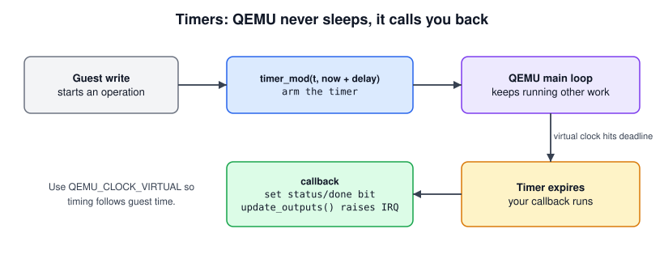

### 11.1 One-shot timers (`QEMUTimer`)

```c
static void mydev_timer_cb(void *opaque)
{
    MyDevState *s = opaque;
    s->regs[REG_STATUS] |= STATUS_DONE;     /* operation finished */
    mydev_update_outputs(s);                /* may raise the IRQ  */
}

/* realize */
s->timer = timer_new_ns(QEMU_CLOCK_VIRTUAL, mydev_timer_cb, s);

/* in the register-write handler, when the guest starts an operation */
timer_mod(s->timer,
          qemu_clock_get_ns(QEMU_CLOCK_VIRTUAL) + 5 * SCALE_MS);
```

Re-arm from inside the callback for periodic behavior. Use `timer_del(s->timer)` to cancel, and do so in reset.

### 11.2 Counters and prescalers (`ptimer`)

For down-counters with a programmable frequency and reload value (the usual hardware timer), `ptimer` does the math for you:

```c
s->pt = ptimer_init(mydev_tick, s, PTIMER_POLICY_LEGACY);
ptimer_transaction_begin(s->pt);
ptimer_set_freq(s->pt, 1000000);     /* 1 MHz tick */
ptimer_set_limit(s->pt, reload, 1);  /* reload value */
ptimer_run(s->pt, 0);                /* 0 = periodic, 1 = one-shot */
ptimer_transaction_commit(s->pt);
```

Changes to a `ptimer` must be wrapped in `ptimer_transaction_begin/commit`. Reading the live counter is `ptimer_get_count(s->pt)`.

### 11.3 Timer rules of thumb

- Use **`QEMU_CLOCK_VIRTUAL`** so timing follows guest time (it stops when the VM is paused).
- A callback is just another state change: finish with `update_outputs`.
- Convert hardware units to nanoseconds (`ticks * NANOSECONDS_PER_SECOND / freq`) when arming.
- **Cancel in reset**, and **migrate timers** in VMState (`VMSTATE_TIMER_PTR` / `VMSTATE_PTIMER`).
- Do not busy-wait. If hardware "waits", set a timer.

---

## 12. VMState: Describing Device State

**Every device should describe its mutable state in a VMState description.** QEMU uses it for **snapshots and live migration**.

Rule of thumb: **if a field changes after reset and affects behavior, it belongs in VMState.** Fields fixed at realize (properties) or derived from other state don't.

```c
static const VMStateDescription vmstate_mydev = {
    .name = TYPE_MYDEV,
    .version_id = 1,
    .minimum_version_id = 1,
    .fields = (const VMStateField[]) {
        VMSTATE_UINT8_ARRAY(regs, MyDevState, MYDEV_NUM_REGS),
        VMSTATE_UINT8(ptr, MyDevState),
        VMSTATE_BOOL(got_ptr, MyDevState),
        VMSTATE_UINT8(pin_in_level, MyDevState),
        VMSTATE_TIMER_PTR(timer, MyDevState),
        VMSTATE_I2C_SLAVE(parent_obj, MyDevState),   /* parent state too */
        VMSTATE_END_OF_LIST()
    }
};
```

Bump `version_id` when the layout changes. Output line levels are not saved: re-derive them with `update_outputs` in a `post_load` hook if needed.

---

## 13. Build Integration

A new `.c` file is **not compiled until the build files mention it**.

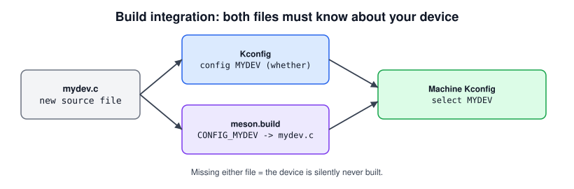

| File | Decides |
|---|---|
| **Kconfig** | *Whether* a device is built (config option, dependencies) |
| **meson.build** | *Which files* that means |

```kconfig
# hw/misc/Kconfig
config MYDEV
    bool
    depends on I2C
```

```meson
# hw/misc/meson.build
system_ss.add(when: 'CONFIG_MYDEV', if_true: files('mydev.c'))
```

Machines that use the device `select MYDEV` in their own Kconfig entry. Re-run `ninja` after changes (Meson reconfigures automatically). If your device doesn't show up, check these two files first.

---

## 14. Using and Debugging Your Device

### 14.1 Running

A device wired by board code just exists when you boot that machine:

```sh
qemu-system-<arch> -M myboard -kernel firmware.elf -nographic
```

A device that is **not** hardwired can be added from the command line (it must be a *pluggable* type):

```sh
qemu-system-<arch> -M myboard -device mydev,config=3
```

### 14.2 Inspect the machine

In the monitor (`-monitor stdio` or `Ctrl-A C` with `-nographic`):

| Command | Shows |
|---|---|
| `info qtree` | The device tree with every property value |
| `info mtree` | The memory map (MMIO regions and addresses) |
| `info irq` | Interrupt counts, where supported |
| `qom-list /machine/...` | QOM paths and properties |
| `xp /4wx 0x60001000` | Read guest-physical memory/registers |

### 14.3 Logging

```sh
-d guest_errors,unimp          # LOG_GUEST_ERROR and LOG_UNIMP messages
-D qemu.log                    # send logs to a file
```

### 14.4 Trace events

For permanent, low-overhead debug output, add trace points instead of `printf`:

```
# hw/misc/trace-events
mydev_read(uint32_t offset, uint32_t value)  "offset 0x%x value 0x%x"
mydev_write(uint32_t offset, uint32_t value) "offset 0x%x value 0x%x"
mydev_irq(int level)                         "irq level %d"
```

```c
#include "trace.h"
trace_mydev_write(offset, value);
```

Enable at runtime: `-trace "mydev_*"`.

### 14.5 Debugging the guest

```sh
qemu-system-<arch> -M myboard -kernel firmware.elf -s -S   # gdb server on :1234, paused
```

Attach `gdb` and set breakpoints in the *guest*; use QEMU's trace and log output to see how the *device* responded.

---

## 15. Testing with qtest

**qtest checks a device without guest firmware.** QEMU starts with the **qtest accelerator**, which **replaces the CPU**: no guest code runs. The test drives the device **directly through a socket**.

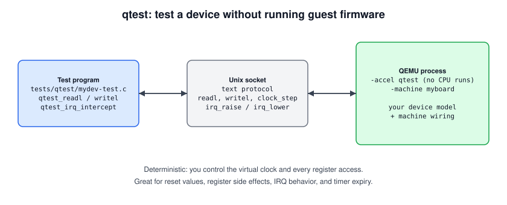

### 15.1 What you can do from a test

| Call | Purpose |
|---|---|
| `qtest_init("-machine myboard")` | Start QEMU in qtest mode |
| `qtest_readb/w/l/q`, `qtest_writeb/w/l/q` | Access guest-physical (MMIO) addresses |
| `qtest_irq_intercept_in/out` | Watch or drive qemu_irq lines |
| `qtest_get_irq(qts, n)` | Read the level of an intercepted line |
| `qtest_clock_step(qts, ns)` | Advance virtual time (fires timers) |
| `qtest_system_reset(qts)` | Trigger a reset |
| `qtest_quit(qts)` | Shut down |

### 15.2 Example: reset values, side effects, timer, and IRQ

```c
#define BASE 0x60001000

static void test_reset_values(void)
{
    QTestState *qts = qtest_init("-machine myboard");

    g_assert_cmphex(qtest_readl(qts, BASE + REG_DIRECTION * 4), ==, 0xFF);

    qtest_quit(qts);
}

static void test_write_readback(void)
{
    QTestState *qts = qtest_init("-machine myboard");

    qtest_writel(qts, BASE + REG_POLARITY * 4, 0x55);
    g_assert_cmphex(qtest_readl(qts, BASE + REG_POLARITY * 4), ==, 0x55);

    qtest_quit(qts);
}

static void test_timer_and_irq(void)
{
    QTestState *qts = qtest_init("-machine myboard");

    /* watch the device's output line */
    qtest_irq_intercept_out(qts, "/machine/soc/mydev");

    qtest_writel(qts, BASE + REG_CTRL * 4, CTRL_START);   /* start operation */
    g_assert_false(qtest_get_irq(qts, 0));                /* not done yet    */

    qtest_clock_step(qts, 6 * SCALE_MS);                  /* let timer expire */

    g_assert_true(qtest_get_irq(qts, 0));                 /* IRQ raised      */
    g_assert_cmphex(qtest_readl(qts, BASE + REG_STATUS * 4) & STATUS_DONE,
                    ==, STATUS_DONE);

    qtest_writel(qts, BASE + REG_STATUS * 4, STATUS_DONE); /* W1C */
    g_assert_false(qtest_get_irq(qts, 0));                /* IRQ cleared     */

    qtest_quit(qts);
}

int main(int argc, char **argv)
{
    g_test_init(&argc, &argv, NULL);
    qtest_add_func("/mydev/reset",     test_reset_values);
    qtest_add_func("/mydev/readback",  test_write_readback);
    qtest_add_func("/mydev/timer-irq", test_timer_and_irq);
    return g_test_run();
}
```

### 15.3 Register and run

```meson
# tests/qtest/meson.build
qtests_<arch> += { 'mydev-test': [] }
```

```sh
ninja -C build
meson test -C build --suite qtest      # or run one: build/tests/qtest/mydev-test
```

### 15.4 What to test

- Power-on **reset values** of every register.
- **Write/readback**, plus read-only, reserved, and write-1-to-clear rules.
- **Side effects** (read-to-clear, triggers).
- **Interrupts**: assert on cause, deassert when cleared, masking.
- **Timers**: not fired early, fired after `qtest_clock_step`, periodic reload.
- **Reset mid-operation**: pending timers cancelled, outputs re-driven.
- **Bad access**: out-of-range offsets don't crash QEMU.

For I2C/SPI devices, `tests/qtest/libqos/` has helpers for issuing bus transactions. For firmware-level confidence, follow qtest with a real guest-boot smoke test.

---

## 16. Common Pitfalls

| Pitfall | Fix |
|---|---|
| Device never builds or never appears | Check Kconfig, `meson.build`, and that the machine `select`s it |
| Using `offset` as an absolute address | It's relative to the region base |
| Reset logic only in `realize` | Put power-on values in the reset handler |
| Outputs go stale | Funnel all changes through one `update_outputs()` |
| Treating IRQ as an edge | `qemu_irq` is a level; hold it until the cause is cleared |
| Blocking or sleeping in a callback | Use a timer; callbacks must return immediately |
| Timer survives reset / not migrated | `timer_del` in reset; add the timer to VMState |
| State missing from VMState | Anything that changes at runtime and affects behavior goes in |
| Wrong access size / endianness | Set `valid`/`impl` sizes and `.endianness` to match hardware |
| Crash on unexpected guest access | Log `LOG_GUEST_ERROR`, return 0 / ignore, never assert on guest input |
| Unmodeled peripherals crash firmware | `create_unimplemented_device()` and watch `-d unimp` |
| Modeling signal timing | Don't: model transactions and state, not waveforms |

---

## 17. Checklist

1. **Read the datasheet** and map each line to a QEMU mechanism (6.1).
2. **Write the header**: type name, register offsets, state struct (6.3).
3. **Write the register layer**: decode, side effects, write rules, no bus knowledge (7).
4. **Write the bus layer** (I2C/SPI callbacks) or **MMIO ops** that call the register layer (8, 9).
5. **Add GPIO/IRQ lines**: inputs with handlers, outputs via one `update_outputs` (10).
6. **Add timers** for anything time-dependent (11).
7. **Write reset** with power-on values, cancelling timers (5.4).
8. **Add VMState** for all mutable state (12).
9. **Register the type**, `class_init`, properties (4, 5).
10. **Hook up the build** with Kconfig and `meson.build` (13).
11. **Wire it into a board**: create, set properties, realize, map MMIO, connect IRQs (8.2, 9.4, 10.3).
12. **Add trace events** and check `info mtree` / `info qtree` (14).
13. **Test with qtest** (15).

---

## 18. Glossary

| Term | Meaning |
|---|---|
| **TCG** | Tiny Code Generator: JIT translating guest code to host code |
| **MMIO** | Memory-mapped I/O: registers at physical addresses |
| **MemoryRegion** | A window of the address space backed by RAM or by your callbacks |
| **SysBusDevice** | Device type that sits directly on the system bus / address space |
| **QOM** | QEMU Object Model: classes, inheritance, type checks in C |
| **qdev** | Device layer over QOM: lifecycle, reset, props, buses, GPIO |
| **Class struct** | One per type: function pointers, shared data |
| **Instance struct** | One per object: per-device state |
| **Realize** | The point where a configured device becomes live |
| **Property** | Typed setting the board sets before realize |
| **`qemu_irq`** | One-bit level signal between devices (pin / interrupt / reset) |
| **Callback** | A C function whose pointer is handed to QEMU to be called on an event |
| **QEMUTimer / ptimer** | One-shot callback timer / programmable down-counter |
| **VMState** | Description of mutable state for snapshots and migration |
| **Kconfig / Meson** | Decide whether a device is built / which files that includes |
| **qtest** | Firmware-free device testing through a socket |
